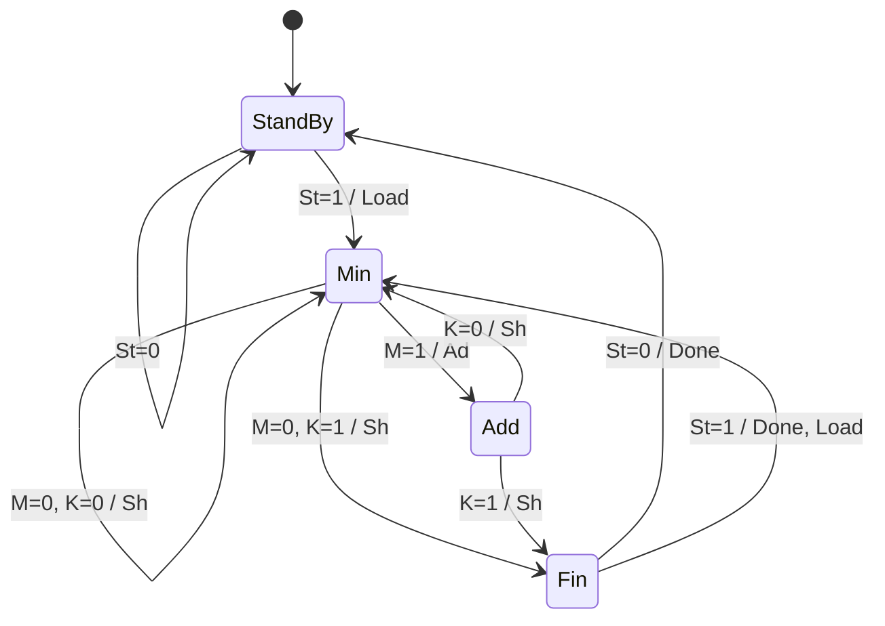

# FPGA & Vivado 작업 아카이브

> 여러 PC(Vivado 2025.2 / 2026.1)에서 동기화되는 HDL 작업 저장소입니다. 푸시하면 각 프로젝트의 `note.md`와 RTL 모듈 구조가 아래에 자동으로 정리됩니다. (이 파일은 `scripts/update_readme.py`가 생성하므로 직접 수정하지 마세요.)

## 사용법

```tcl
# Vivado Tcl Console (어느 버전이든)
cd C:/경로/리포지토리/projects/<작업명>
source ../../scripts/create_proj.tcl
```

## 전체 작업 목록

| 프로젝트 | 한 줄 요약 | 포함 모듈 | 최근 업데이트 |
| :--- | :--- | :--- | :--- |
| [**13.11**](#1311) | - | `master` | 2026-11-01 |
| [**13.25**](#1325) | - | `dff`, `main` | 2026-11-01 |
| [**13.26**](#1326) | - | `jkff`, `main` | 2026-11-01 |
| [**13.262**](#13262) | - | `main` | 2026-11-01 |
| [**14.43a**](#1443a) | - | `master` | 2026-11-01 |
| [**14.44**](#1444) | - | `master` | 2026-11-01 |
| [**14.6**](#146) | - | `master` | 2026-11-01 |
| [**16.29**](#1629) | - | `main` | 2026-11-01 |
| [**counter2421**](#counter2421) | - | `counter2421` | 2026-11-01 |
| [**counter_12prac**](#counter_12prac) | - | `counter`, `counter_tb` | 2026-11-01 |
| [**dice**](#dice) | - | `main` | 2026-11-11 |
| [**full adder**](#full-adder-full_adder) | - | `fullAdder` | 2026-11-01 |
| [**4-bit Shift-Add Multiplier (Roth & Kinney 18.2 / Fig. 19-10)**](#4-bit-shift-add-multiplier-roth--kinney-182--fig-19-10-multiplier) | - | `main` | 2026-11-08 |
| [**P10D**](#p10d) | - | `count`, `decod38` | 2026-11-01 |
| [**P10E**](#p10e) | - | `bcdconv`, `decod4to16`, `Master` | 2026-11-01 |
| [**P10I**](#p10i) | - | `master`, `mux21`, `pEnc` | 2026-11-01 |
| [**P10J**](#p10j) | - | `adder`, `adder2`, `mas` | 2026-11-01 |
| [**P10K**](#p10k) | - | `buff3`, `decod24`, `mas` | 2026-11-01 |
| [**P10K_desktop2**](#p10k_desktop2) | - | `buffer3`, `decod24`, `master` | 2026-11-01 |
| [**P10N**](#p10n) | - | `mEnc`, `pEnc` | 2026-11-01 |
| [**P1232**](#p1232) | - | `SRff`, `Ucount` | 2026-11-01 |
| [**P1234**](#p1234) | - | `ring_counter_jk` | 2026-11-05 |
| [**practice_1**](#practice_1) | - | `ad2`, `ad42`, `wires`, `simple_gates` | 2026-11-01 |
| [**project_1**](#project_1) | - | `wires` | 2026-11-01 |
| [**project_1_desktop2**](#project_1_desktop2) | - | `F101`, `ANDP`, `CLKP`, `P10C`, `P1014`, `P1017`, `P10172`, `P1018`, `P10A`, `P10AR`, `P10C` | 2026-11-01 |
| [**project_2**](#project_2) | - | `P1010`, `P1011`, `P104`, `P10B` | 2026-11-01 |
| [**project_2_desktop2**](#project_2_desktop2) | - | `fulladder`, `P10C` | 2026-11-01 |
| [**project_3**](#project_3) | - | `bcdconv`, `decod4to16`, `Master` | 2026-11-01 |
| [**project_4**](#project_4) | - | `qw` | 2026-11-01 |
| [**ringcounter**](#ringcounter) | - | `flip`, `ring_counter_top` | 2026-11-05 |
| [**thermostat**](#thermostat) | - | `thermostat` | 2026-11-01 |

## 프로젝트별 상세 노트 및 모듈 명세

### 13.11

- **폴더**: [`projects/13.11`](projects/13.11) · [note.md](projects/13.11/note.md)
- **요약**: -
- **최근 업데이트**: 2026-11-01
- **시뮬레이션 파일**: `tb_1411.sv`

#### 작업 노트

_상세 노트 없음_

<details><summary>RTL 모듈 및 포트 요약</summary>

| 소스 파일 | 모듈명 | 방향 | 비트폭 | 포트명 |
| :--- | :--- | :--- | :--- | :--- |
| `master.sv` | **`master`** | `input` | `1` | `clk` |
|  |  | `input` | `1` | `rst_n` |
|  |  | `input` | `1` | `x` |
|  |  | `output` | `1` | `z` |

</details>

### 13.25

- **폴더**: [`projects/13.25`](projects/13.25) · [note.md](projects/13.25/note.md)
- **요약**: -
- **최근 업데이트**: 2026-11-01
- **시뮬레이션 파일**: `sim1.sv`, `tb_13_25.sv`

#### 작업 노트

_상세 노트 없음_

<details><summary>RTL 모듈 및 포트 요약</summary>

| 소스 파일 | 모듈명 | 방향 | 비트폭 | 포트명 |
| :--- | :--- | :--- | :--- | :--- |
| `dff.sv` | **`dff`** | `input` | `1` | `d` |
|  |  | `input` | `1` | `clk` |
|  |  | `output` | `1` | `q` |
| `main.sv` | **`main`** | `input` | `1` | `x` |
|  |  | `input` | `1` | `clk` |
|  |  | `output` | `1` | `z` |

</details>

### 13.26

- **폴더**: [`projects/13.26`](projects/13.26) · [note.md](projects/13.26/note.md)
- **요약**: -
- **최근 업데이트**: 2026-11-01
- **시뮬레이션 파일**: `sim.sv`

#### 작업 노트

_상세 노트 없음_

<details><summary>RTL 모듈 및 포트 요약</summary>

| 소스 파일 | 모듈명 | 방향 | 비트폭 | 포트명 |
| :--- | :--- | :--- | :--- | :--- |
| `jkff.sv` | **`jkff`** | `input` | `1` | `j` |
|  |  | `input` | `1` | `k` |
|  |  | `input` | `1` | `clk` |
|  |  | `input` | `1` | `rst_n` |
|  |  | `output` | `1` | `o` |
|  |  | `output` | `1` | `o2` |
| `main.sv` | **`main`** | `input` | `1` | `x` |
|  |  | `input` | `1` | `clk` |
|  |  | `input` | `1` | `rst_n` |
|  |  | `output` | `1` | `z` |

</details>

### 13.262

- **폴더**: [`projects/13.262`](projects/13.262) · [note.md](projects/13.262/note.md)
- **요약**: -
- **최근 업데이트**: 2026-11-01
- **시뮬레이션 파일**: `tb_13_26_2.sv`

#### 작업 노트

_상세 노트 없음_

<details><summary>RTL 모듈 및 포트 요약</summary>

| 소스 파일 | 모듈명 | 방향 | 비트폭 | 포트명 |
| :--- | :--- | :--- | :--- | :--- |
| `main.sv` | **`main`** | `input` | `1` | `x1` |
|  |  | `input` | `1` | `x2` |
|  |  | `input` | `1` | `clk` |
|  |  | `input` | `1` | `rst_n` |
|  |  | `output` | `1` | `z1` |
|  |  | `output` | `1` | `z2` |

</details>

### 14.43a

- **폴더**: [`projects/14.43a`](projects/14.43a) · [note.md](projects/14.43a/note.md)
- **요약**: -
- **최근 업데이트**: 2026-11-01
- **시뮬레이션 파일**: `tb_master_seq.sv`

#### 작업 노트

_상세 노트 없음_

<details><summary>RTL 모듈 및 포트 요약</summary>

| 소스 파일 | 모듈명 | 방향 | 비트폭 | 포트명 |
| :--- | :--- | :--- | :--- | :--- |
| `master.sv` | **`master`** | `input` | `1` | `x` |
|  |  | `input` | `1` | `clk` |
|  |  | `input` | `1` | `rst_n` |
|  |  | `output` | `1` | `z` |

</details>

### 14.44

- **폴더**: [`projects/14.44`](projects/14.44) · [note.md](projects/14.44/note.md)
- **요약**: -
- **최근 업데이트**: 2026-11-01

#### 작업 노트

_상세 노트 없음_

<details><summary>RTL 모듈 및 포트 요약</summary>

| 소스 파일 | 모듈명 | 방향 | 비트폭 | 포트명 |
| :--- | :--- | :--- | :--- | :--- |
| `master.sv` | **`master`** | `input` | `1` | `r` |
|  |  | `input` | `1` | `a` |
|  |  | `input` | `1` | `s` |
|  |  | `input` | `1` | `rst_n` |
|  |  | `input` | `1` | `clk` |
|  |  | `output` | `1` | `z` |

</details>

### 14.6

- **폴더**: [`projects/14.6`](projects/14.6) · [note.md](projects/14.6/note.md)
- **요약**: -
- **최근 업데이트**: 2026-11-01

#### 작업 노트

_상세 노트 없음_

<details><summary>RTL 모듈 및 포트 요약</summary>

| 소스 파일 | 모듈명 | 방향 | 비트폭 | 포트명 |
| :--- | :--- | :--- | :--- | :--- |
| `master.sv` | **`master`** | - | - | _포트 없음 (테스트벤치 등)_ |

</details>

### 16.29

- **폴더**: [`projects/16.29`](projects/16.29) · [note.md](projects/16.29/note.md)
- **요약**: -
- **최근 업데이트**: 2026-11-01
- **시뮬레이션 파일**: `simul.sv`

#### 작업 노트

_상세 노트 없음_

<details><summary>RTL 모듈 및 포트 요약</summary>

| 소스 파일 | 모듈명 | 방향 | 비트폭 | 포트명 |
| :--- | :--- | :--- | :--- | :--- |
| `main.sv` | **`main`** | `input` | `1` | `fb1` |
|  |  | `input` | `1` | `fb2` |
|  |  | `input` | `1` | `call1` |
|  |  | `input` | `1` | `call2` |
|  |  | `input` | `1` | `fs1` |
|  |  | `input` | `1` | `fs2` |
|  |  | `input` | `1` | `clk` |
|  |  | `input` | `1` | `rst_n` |
|  |  | `output` | `1` | `up` |
|  |  | `output` | `1` | `down` |

</details>

### counter2421

- **폴더**: [`projects/counter2421`](projects/counter2421) · [note.md](projects/counter2421/note.md)
- **요약**: -
- **최근 업데이트**: 2026-11-01
- **시뮬레이션 파일**: `counter2421_tb.sv`

#### 작업 노트

_상세 노트 없음_

<details><summary>RTL 모듈 및 포트 요약</summary>

| 소스 파일 | 모듈명 | 방향 | 비트폭 | 포트명 |
| :--- | :--- | :--- | :--- | :--- |
| `counter2421.sv` | **`counter2421`** | `input` | `1` | `ClrN` |
|  |  | `output` | `[3:0]` | `q` |
|  |  | `input` | `1` | `clk` |

</details>

### counter_12prac

- **폴더**: [`projects/counter_12prac`](projects/counter_12prac) · [note.md](projects/counter_12prac/note.md)
- **요약**: -
- **최근 업데이트**: 2026-11-01

#### 작업 노트

_상세 노트 없음_

<details><summary>RTL 모듈 및 포트 요약</summary>

| 소스 파일 | 모듈명 | 방향 | 비트폭 | 포트명 |
| :--- | :--- | :--- | :--- | :--- |
| `counter.sv` | **`counter`** | `input` | `1` | `clk` |
|  |  | `input` | `1` | `reset_n` |
|  |  | `output` | `[2:0]` | `cba` |
| `counter_tb.sv` | **`counter_tb`** | - | - | _포트 없음 (테스트벤치 등)_ |

</details>

### dice

- **폴더**: [`projects/dice`](projects/dice) · [note.md](projects/dice/note.md)
- **요약**: -
- **최근 업데이트**: 2026-11-11

#### 작업 노트

### 작업 내용 및 핵심 설계
- 

Fundamental Logic Design Figure 19-11을 SM차트 그린 후 SV로 구현

### 테스트 / 트러블슈팅 메모
1차 작성한 SV:

`timescale 1ns / 1ps
module main(
    input logic rb,clk,
    input logic rst,rst_n,//rst is reset input button while rst_n is total reset no matter what
    output logic won, lost
    );
    //6 states
    typedef enum logic [2:0]{
        standby1=3'b000,
        roll1=3'b001,
        win=3'b010,
        standby2=3'b011,
        lose=3'b101,
        roll2=3'b100
        } state_t;
        
        state_t current,next;
        
        always_ff@(posedge clk or negedge rst_n) begin
            if (!rst_n)  
                current<=standby1;
            else current<=next;
        end
                
        logic [2:0]counter1;
        logic [2:0]counter2;
        logic [3:0]sum;
        logic roll;
        logic [3:0]point;
        logic [3:0]display1;
        logic [3:0]display2;
        
        //fsm sm chart to SV
        always_comb begin
            next=current;
            roll=1'b0;//set default it is a signal that enables counter to roll
            point=3'b0000;
            
            case(current)
                standby1: begin //s0
                    if (!rb) next=standby1;
                    else if (rb) next=roll1;
                end
                
                roll1: begin //s1
                    if(rb) begin
                        next=roll1;
                        roll=1'b1; //use roll to roll counter
                    end
                    
                    else if (!rb)
                        roll=1'b0;
                        if (sum==7|11) begin
                            next=win;
                        end
                        else if (sum==2|3|12) begin 
                            next=lose;
                        end
                        else
                            point=sum; //point is saved by sum
                            next=standby2;
                end
                
                standby2: begin //s3
                    if (!rb) next=standby2;
                    else if (rb) next=roll2;
                end
                
                roll2: begin //s5
                    if(rb) begin
                        next=roll2;
                        roll=1'b1;//use roll to roll counter
                    end
                    
                    else if (!rb)
                        roll=1'b0;
                        if (sum==point) begin//check if the sum is equal topoint that is saved
                            next=win;
                        end
                        else if (sum==7) begin
                            next=lose;
                        end
                        else
                            next=standby2;                        
                end
               
                win: begin //s2
                    if(!rst) next=win;
                    else next=standby1;
                end
                lose: begin //s2
                    if(!rst) next=lose;
                    else next=standby1;
                end
            endcase
        end
        

        //Dice counter
        always_ff@(posedge clk or negedge rst_n) begin
            if(!rst_n)begin
                counter1<=3'd1;
                counter2<=3'd1;
            end
            else if(roll==1) begin
                if(counter1==3'd6) begin
                    counter1<=3'd1;
                end
                else counter1<=counter1+3'd1;
                
                if(counter2==3'd6) begin
                    counter2<=3'd1;
                end
                else counter2<=counter2+3'd1;
            end
            
            else if (!roll) begin
                display1=counter1;
                display2=counter2;
            end
        end
        
        always_ff@(negedge clk or negedge rst_n) begin// I did negedge clk because counter1 and 2 values are set at posedge which mean at the next negedge will give proper counter1,2 values
            if (!rst_n) begin
                sum<=3'd0;
            end
            else if (!roll) 
                sum=counter1+counter2;
            end  
        
endmodule

Claude F/B:
**60점.** 구조는 잘 잡았어. 그런데 시뮬레이션을 돌리면 동작이 크게 틀릴 버그가 몇 개 있어. 심각한 것부터 힌트로 줄게.

## 잘한 점
- 리셋 두 종류를 구분하고 주석으로 이유까지 남겼어 (rst 버튼 vs rst_n 전체 리셋).
- roll을 따로 신호로 만들고 기본값을 0으로 뒀어.
- 카운터가 1→6→1로 도는 것 정확해.

## 꼭 고쳐야 할 것 (동작이 틀림)

**1. `else if (!rb)` 다음에 `begin`이 없어**
- `begin/end` 없이 쓰면 바로 다음 한 줄만 else에 속해.
- 그러면 그 아래 `if (sum==...)`는 rb와 상관없이 항상 실행돼.
- 맨 끝 `else point=sum; next=standby2;`도 같은 문제야. `next=standby2`가 어디에 속할까?

**2. `sum==7|11`은 네 생각대로 계산되지 않아**
- 연산자 우선순위상 `==`가 `|`보다 먼저 계산돼.
- 그러면 `(sum==7) | 11`이 되는데, 이 값은 항상 몇일까?

**3. 두 카운터가 항상 같이 움직여**
- 둘이 동시에 1→6을 돌면 두 눈이 항상 같아.
- 그러면 합이 7이나 11이 나올 수 있을까?

**4. point가 기억을 못 해**
- `always_comb`에서 매번 0으로 초기화하니까, 다음 클럭엔 저장한 값이 사라져.
- 기억해야 하는 값은 어디에 써야 하지? (곱셈기 ACC는 어디 있었어?)
- 거기에 Sp 신호까지 만들면 책 구조와 똑같아져.

**5. won, lost 출력을 아무 데서도 안 정해 줘**
- 포트만 선언했고 값을 넣는 곳이 없어.

## 다듬을 것

**6. sum은 negedge 플립플롭일 필요가 없어**
- 카운터 값은 상승 엣지 직후 바로 안정돼.
- 컨트롤러가 그 값을 쓰는 건 다음 상승 엣지야.
- 그래서 sum은 조합(`assign`)이면 충분해. 클럭 엣지를 섞으면 반 클럭짜리 경로가 생겨서 오히려 위험해.

**7. display1/2**
- `always_ff` 안에서 `=`(blocking)를 쓰고 있어.
- 화면에 보여야 하는데 출력 포트가 아니야.
- 카운터 값을 그대로 보여 주면 되는 신호야.

**8. 기타**
- `case`에 `default`가 없어. 3비트 중 6개만 써서 남는 코드 2개가 있어.
- `point=3'b0000`, `sum<=3'd0`처럼 신호 폭과 숫자 폭이 안 맞아.
- 주석 상태 번호가 틀렸어 (lose가 //s2).

1~5번만 고쳐도 동작할 거야. 고치면 TB 짜기 전에 다시 보여 줘.

<details><summary>RTL 모듈 및 포트 요약</summary>

| 소스 파일 | 모듈명 | 방향 | 비트폭 | 포트명 |
| :--- | :--- | :--- | :--- | :--- |
| `main.sv` | **`main`** | `input` | `1` | `rb` |
|  |  | `input` | `1` | `clk` |
|  |  | `input` | `1` | `rst` |
|  |  | `input` | `1` | `rst_n` |
|  |  | `output` | `1` | `won` |
|  |  | `output` | `1` | `lost` |

</details>

### full adder (full_adder)

- **폴더**: [`projects/full_adder`](projects/full_adder) · [note.md](projects/full_adder/note.md)
- **요약**: -
- **최근 업데이트**: 2026-11-01

#### 작업 노트

_상세 노트 없음_

<details><summary>RTL 모듈 및 포트 요약</summary>

| 소스 파일 | 모듈명 | 방향 | 비트폭 | 포트명 |
| :--- | :--- | :--- | :--- | :--- |
| `fullAdder.sv` | **`fullAdder`** | `input` | `1` | `a` |
|  |  | `input` | `1` | `b` |
|  |  | `input` | `1` | `ci` |
|  |  | `output` | `1` | `s` |
|  |  | `output` | `1` | `co` |

</details>

### 4-bit Shift-Add Multiplier (Roth & Kinney 18.2 / Fig. 19-10) (multiplier)

- **폴더**: [`projects/multiplier`](projects/multiplier) · [note.md](projects/multiplier/note.md)
- **요약**: -
- **최근 업데이트**: 2026-11-08
- **시뮬레이션 파일**: `simul.sv`

#### 작업 노트

## Overview
 
| Signal | Meaning |
|---|---|
| `ACC[8:0]` | 9-bit accumulator = carry (1) + partial product (4) + multiplier (4) |
| `M` | LSB of ACC, $M = ACC[0]$ |
| `K` | Counter flag, $K = 1$ when the counter has shifted 3 times ($cnt = 3$) |
| `Load` | $ACC \leftarrow \{5'b0,\ ier\}$, counter $\leftarrow 0$ |
| `Ad` | $ACC[8:4] \leftarrow ACC[8:4] + cand$ |
| `Sh` | $ACC \leftarrow ACC \gg 1$, counter $\leftarrow cnt + 1$ |
| `Done` | Multiplication finished, $prod = ACC[7:0]$ |
 
## Controller State Table
 
| # | Present State | Input | Next State | Output | Explanation |
|:-:|---|---|---|---|---|
| 1 | StandBy | $St = 0$ | StandBy | – | Standby at the beginning |
| 2 | StandBy | $St = 1$ | Min | Load | Multiplier is loaded into the lower 4 bits; $M$ is sent to the controller |
| 3 | Min | $M = 0,\ K = 0$ | Min | Sh | No addition, just shift |
| 4 | Min | $M = 1$ | Add | Ad | Add first |
| 5 | Add | $K = 0$ | Min | Sh | After addition, shift |
| 6 | Min | $M = 0,\ K = 1$ | Fin | Sh | Last shift, then end |
| 7 | Add | $K = 1$ | Fin | Sh | Last shift after addition, then end |
| 8 | Fin | $St = 0$ | StandBy | Done | Back to standby |
| 9 | Fin | $St = 1$ | Min | Done, Load | Restart right after done (not in the textbook; S3 → S0 in Fig. 19-10) |
 
## State Assignment
 
| $Q_0 \backslash Q_1$ | 0 | 1 |
|:-:|:-:|:-:|
| **0** | StandBy (00) | Min (10) |
| **1** | Fin (01) | Add (11) |
 
## State Diagram
 

 
## Simulation Result
 
Test cases: 11×13 = 143, 5×3 = 15, 0×7 = 0, 15×15 = 225, 8×1 = 8 → **ALL PASS**
 
<!-- 파형 캡처 넣는 자리 -->

<details><summary>RTL 모듈 및 포트 요약</summary>

| 소스 파일 | 모듈명 | 방향 | 비트폭 | 포트명 |
| :--- | :--- | :--- | :--- | :--- |
| `main.sv` | **`main`** | `input` | `1` | `clk` |
|  |  | `input` | `1` | `rst_n` |
|  |  | `input` | `1` | `st` |
|  |  | `input` | `[3:0]` | `ier` |
|  |  | `input` | `[3:0]` | `cand` |
|  |  | `output` | `[7:0]` | `prod` |
|  |  | `output` | `1` | `done` |

</details>

### P10D

- **폴더**: [`projects/P10D`](projects/P10D) · [note.md](projects/P10D/note.md)
- **요약**: -
- **최근 업데이트**: 2026-11-01

#### 작업 노트

_상세 노트 없음_

<details><summary>RTL 모듈 및 포트 요약</summary>

| 소스 파일 | 모듈명 | 방향 | 비트폭 | 포트명 |
| :--- | :--- | :--- | :--- | :--- |
| `count.sv` | **`count`** | `input` | `1` | `a` |
|  |  | `input` | `1` | `b` |
|  |  | `input` | `1` | `c` |
|  |  | `output` | `[1:0]` | `count` |
| `decod38.sv` | **`decod38`** | `input` | `1` | `a` |
|  |  | `input` | `1` | `b` |
|  |  | `input` | `1` | `c` |
|  |  | `output` | `[7:0]` | `y` |

</details>

### P10E

- **폴더**: [`projects/P10E`](projects/P10E) · [note.md](projects/P10E/note.md)
- **요약**: -
- **최근 업데이트**: 2026-11-01

#### 작업 노트

_상세 노트 없음_

<details><summary>RTL 모듈 및 포트 요약</summary>

| 소스 파일 | 모듈명 | 방향 | 비트폭 | 포트명 |
| :--- | :--- | :--- | :--- | :--- |
| `bcdconv.sv` | **`bcdconv`** | `input` | `[3:0]` | `a` |
|  |  | `output` | `[6:0]` | `f` |
| `decod4to16.sv` | **`decod4to16`** | `input` | `[3:0]` | `a` |
|  |  | `output` | `[15:0]` | `f` |
| `Master.sv` | **`Master`** | - | - | _포트 없음 (테스트벤치 등)_ |

</details>

### P10I

- **폴더**: [`projects/P10I`](projects/P10I) · [note.md](projects/P10I/note.md)
- **요약**: -
- **최근 업데이트**: 2026-11-01
- **시뮬레이션 파일**: `simul.sv`

#### 작업 노트

_상세 노트 없음_

<details><summary>RTL 모듈 및 포트 요약</summary>

| 소스 파일 | 모듈명 | 방향 | 비트폭 | 포트명 |
| :--- | :--- | :--- | :--- | :--- |
| `master.sv` | **`master`** | `input` | `[7:0]` | `y` |
|  |  | `output` | `1` | `a` |
|  |  | `output` | `1` | `b` |
|  |  | `output` | `1` | `c` |
|  |  | `output` | `1` | `d` |
| `mux21.sv` | **`mux21`** | `input` | `1` | `I0` |
|  |  | `input` | `1` | `I1` |
|  |  | `input` | `1` | `e` |
|  |  | `output` | `1` | `f` |
| `pEnc.sv` | **`pEnc`** | `input` | `[3:0]` | `y` |
|  |  | `output` | `1` | `a` |
|  |  | `output` | `1` | `b` |
|  |  | `output` | `1` | `c` |

</details>

### P10J

- **폴더**: [`projects/P10J`](projects/P10J) · [note.md](projects/P10J/note.md)
- **요약**: -
- **최근 업데이트**: 2026-11-01
- **시뮬레이션 파일**: `simul.sv`

#### 작업 노트

_상세 노트 없음_

<details><summary>RTL 모듈 및 포트 요약</summary>

| 소스 파일 | 모듈명 | 방향 | 비트폭 | 포트명 |
| :--- | :--- | :--- | :--- | :--- |
| `adder.sv` | **`adder`** | `input` | `[3:0]` | `a` |
|  |  | `input` | `[3:0]` | `b` |
|  |  | `input` | `1` | `ci` |
|  |  | `output` | `[3:0]` | `s` |
|  |  | `output` | `1` | `co` |
| `adder2.sv` | **`adder2`** | `input` | `[3:0]` | `a` |
|  |  | `input` | `[3:0]` | `b` |
|  |  | `input` | `1` | `cin` |
|  |  | `output` | `[3:0]` | `s` |
|  |  | `output` | `1` | `co` |
| `mas.sv` | **`mas`** | `input` | `[7:0]` | `a` |
|  |  | `input` | `[7:0]` | `b` |
|  |  | `output` | `[7:0]` | `c` |
|  |  | `output` | `1` | `bo` |

</details>

### P10K

- **폴더**: [`projects/P10K`](projects/P10K) · [note.md](projects/P10K/note.md)
- **요약**: -
- **최근 업데이트**: 2026-11-01

#### 작업 노트

_상세 노트 없음_

<details><summary>RTL 모듈 및 포트 요약</summary>

| 소스 파일 | 모듈명 | 방향 | 비트폭 | 포트명 |
| :--- | :--- | :--- | :--- | :--- |
| `buff3.sv` | **`buff3`** | `input` | `[5:0]` | `a` |
|  |  | `input` | `1` | `e` |
|  |  | `output` | `[5:0]` | `b` |
| `decod24.sv` | **`decod24`** | - | - | _포트 없음 (테스트벤치 등)_ |
| `mas.sv` | **`mas`** | - | - | _포트 없음 (테스트벤치 등)_ |

</details>

### P10K_desktop2

- **폴더**: [`projects/P10K_desktop2`](projects/P10K_desktop2) · [note.md](projects/P10K_desktop2/note.md)
- **요약**: -
- **최근 업데이트**: 2026-11-01
- **시뮬레이션 파일**: `simul.sv`

#### 작업 노트

_상세 노트 없음_

<details><summary>RTL 모듈 및 포트 요약</summary>

| 소스 파일 | 모듈명 | 방향 | 비트폭 | 포트명 |
| :--- | :--- | :--- | :--- | :--- |
| `buffer3.sv` | **`buffer3`** | `input` | `[5:0]` | `a` |
|  |  | `input` | `1` | `e` |
|  |  | `output` | `[5:0]` | `b` |
| `decod24.sv` | **`decod24`** | `input` | `[1:0]` | `a` |
|  |  | `output` | `[3:0]` | `b` |
| `master.sv` | **`master`** | `input` | `[5:0]` | `i0` |
|  |  | `input` | `[5:0]` | `i1` |
|  |  | `input` | `[5:0]` | `i2` |
|  |  | `input` | `[5:0]` | `i3` |
|  |  | `input` | `[1:0]` | `e` |
|  |  | `output` | `[5:0]` | `f` |

</details>

### P10N

- **폴더**: [`projects/P10N`](projects/P10N) · [note.md](projects/P10N/note.md)
- **요약**: -
- **최근 업데이트**: 2026-11-01
- **시뮬레이션 파일**: `simul.sv`

#### 작업 노트

_상세 노트 없음_

<details><summary>RTL 모듈 및 포트 요약</summary>

| 소스 파일 | 모듈명 | 방향 | 비트폭 | 포트명 |
| :--- | :--- | :--- | :--- | :--- |
| `mEnc.sv` | **`mEnc`** | `input` | `[7:0]` | `y` |
|  |  | `input` | `1` | `e` |
|  |  | `output` | `1` | `a` |
|  |  | `output` | `1` | `b` |
|  |  | `output` | `1` | `c` |
|  |  | `output` | `1` | `d` |
| `pEnc.sv` | **`pEnc`** | `input` | `1` | `i0` |
|  |  | `input` | `1` | `i1` |
|  |  | `input` | `1` | `i2` |
|  |  | `input` | `1` | `i3` |
|  |  | `input` | `1` | `e` |
|  |  | `output` | `1` | `a` |
|  |  | `output` | `1` | `b` |
|  |  | `output` | `1` | `c` |

</details>

### P1232

- **폴더**: [`projects/P1232`](projects/P1232) · [note.md](projects/P1232/note.md)
- **요약**: -
- **최근 업데이트**: 2026-11-01

#### 작업 노트

_상세 노트 없음_

<details><summary>RTL 모듈 및 포트 요약</summary>

| 소스 파일 | 모듈명 | 방향 | 비트폭 | 포트명 |
| :--- | :--- | :--- | :--- | :--- |
| `SRff.sv` | **`SRff`** | - | - | _포트 없음 (테스트벤치 등)_ |
| `Ucount.sv` | **`Ucount`** | `input` | `1` | `rst_n` |
|  |  | `input` | `1` | `clk` |
|  |  | `output` | `[2:0]` | `q` |

</details>

### P1234

- **폴더**: [`projects/P1234`](projects/P1234) · [note.md](projects/P1234/note.md)
- **요약**: -
- **최근 업데이트**: 2026-11-05

#### 작업 노트

_상세 노트 없음_

<details><summary>RTL 모듈 및 포트 요약</summary>

| 소스 파일 | 모듈명 | 방향 | 비트폭 | 포트명 |
| :--- | :--- | :--- | :--- | :--- |
| `ringcounter.sv` | **`ring_counter_jk`** | `input` | `1` | `clk` |
|  |  | `input` | `1` | `preset_n` |
|  |  | `output` | `[7:0]` | `T` |

</details>

### practice_1

- **폴더**: [`projects/practice_1`](projects/practice_1) · [note.md](projects/practice_1/note.md)
- **요약**: -
- **최근 업데이트**: 2026-11-01
- **시뮬레이션 파일**: `ad42_tb.sv`, `ad42_tbvcd.sv`, `simple_gates_tb.sv`

#### 작업 노트

_상세 노트 없음_

<details><summary>RTL 모듈 및 포트 요약</summary>

| 소스 파일 | 모듈명 | 방향 | 비트폭 | 포트명 |
| :--- | :--- | :--- | :--- | :--- |
| `ad2.sv` | **`ad2`** | `input` | `1` | `a` |
|  |  | `input` | `1` | `b` |
|  |  | `output` | `1` | `y` |
| `ad42.sv` | **`ad42`** | `input` | `1` | `A` |
|  |  | `input` | `1` | `B` |
|  |  | `input` | `1` | `C` |
|  |  | `input` | `1` | `D` |
|  |  | `output` | `1` | `Y` |
| `datatype_wires.sv` | **`wires`** | - | - | _포트 없음 (테스트벤치 등)_ |
| `simple_gates.sv` | **`simple_gates`** | `input` | `1` | `a` |
|  |  | `input` | `1` | `b` |
|  |  | `output` | `1` | `and_out` |
|  |  | `output` | `1` | `or_out` |

</details>

### project_1

- **폴더**: [`projects/project_1`](projects/project_1) · [note.md](projects/project_1/note.md)
- **요약**: -
- **최근 업데이트**: 2026-11-01

#### 작업 노트

_상세 노트 없음_

<details><summary>RTL 모듈 및 포트 요약</summary>

| 소스 파일 | 모듈명 | 방향 | 비트폭 | 포트명 |
| :--- | :--- | :--- | :--- | :--- |
| `wires.sv` | **`wires`** | - | - | _포트 없음 (테스트벤치 등)_ |

</details>

### project_1_desktop2

- **폴더**: [`projects/project_1_desktop2`](projects/project_1_desktop2) · [note.md](projects/project_1_desktop2/note.md)
- **요약**: -
- **최근 업데이트**: 2026-11-01

#### 작업 노트

_상세 노트 없음_

<details><summary>RTL 모듈 및 포트 요약</summary>

| 소스 파일 | 모듈명 | 방향 | 비트폭 | 포트명 |
| :--- | :--- | :--- | :--- | :--- |
| `101.vhd` | **`F101`** | `input` | `1` | `A` |
|  |  | `input` | `1` | `B` |
|  |  | `input` | `1` | `C` |
|  |  | `input` | `1` | `D` |
|  |  | `input` | `1` | `E` |
|  |  | `output` | `1` | `I` |
| `ANDP.vhd` | **`ANDP`** | `input` | `1` | `A` |
|  |  | `input` | `1` | `B` |
|  |  | `inout` | `1` | `C` |
|  |  | `input` | `1` | `D` |
|  |  | `output` | `1` | `E` |
| `CLKP.vhd` | **`CLKP`** | - | - | _포트 없음 (테스트벤치 등)_ |
| `Fullader10cm.sv` | **`P10C`** | `input` | `1` | `a` |
|  |  | `input` | `1` | `b` |
|  |  | `input` | `1` | `cin` |
|  |  | `output` | `1` | `s` |
|  |  | `output` | `1` | `co` |
| `P1014.sv` | **`P1014`** | `input` | `[5:0]` | `D` |
|  |  | `input` | `[2:0]` | `E` |
|  |  | `output` | `1` | `F` |
| `P1017.sv` | **`P1017`** | `input` | `1` | `A` |
|  |  | `input` | `1` | `B` |
|  |  | `input` | `1` | `C` |
|  |  | `input` | `1` | `D` |
|  |  | `output` | `1` | `F` |
| `P10172.sv` | **`P10172`** | `input` | `1` | `A` |
|  |  | `input` | `1` | `B` |
|  |  | `input` | `1` | `C` |
|  |  | `input` | `1` | `D` |
|  |  | `output` | `1` | `F` |
| `P1018.sv` | **`P1018`** | `input` | `1` | `A` |
|  |  | `input` | `1` | `B` |
|  |  | `input` | `1` | `C` |
|  |  | `input` | `1` | `D` |
|  |  | `output` | `1` | `E` |
| `P10A.sv` | **`P10A`** | `input` | `1` | `I0` |
|  |  | `input` | `1` | `I1` |
|  |  | `input` | `1` | `E` |
|  |  | `output` | `1` | `F` |
| `P10AR.sv` | **`P10AR`** | `input` | `1` | `A` |
|  |  | `input` | `1` | `B` |
|  |  | `input` | `1` | `I0` |
|  |  | `input` | `1` | `I1` |
|  |  | `input` | `1` | `I2` |
|  |  | `input` | `1` | `I3` |
|  |  | `output` | `1` | `F` |
| `P10C.sv` | **`P10C`** | `input` | `1` | `a` |
|  |  | `input` | `1` | `b` |
|  |  | `output` | `1` | `s` |
|  |  | `output` | `1` | `co` |

</details>

### project_2

- **폴더**: [`projects/project_2`](projects/project_2) · [note.md](projects/project_2/note.md)
- **요약**: -
- **최근 업데이트**: 2026-11-01
- **시뮬레이션 파일**: `P1010s.sv`

#### 작업 노트

_상세 노트 없음_

<details><summary>RTL 모듈 및 포트 요약</summary>

| 소스 파일 | 모듈명 | 방향 | 비트폭 | 포트명 |
| :--- | :--- | :--- | :--- | :--- |
| `P1010.sv` | **`P1010`** | `input` | `1` | `P` |
|  |  | `input` | `1` | `Q` |
|  |  | `input` | `1` | `N` |
|  |  | `output` | `1` | `R` |
| `P1011.sv` | **`P1011`** | `input` | `1` | `A` |
|  |  | `input` | `1` | `B` |
|  |  | `input` | `1` | `D` |
|  |  | `input` | `1` | `E` |
|  |  | `output` | `1` | `H` |
| `P104.sv` | **`P104`** | `input` | `1` | `A` |
|  |  | `input` | `1` | `B` |
|  |  | `input` | `1` | `C` |
|  |  | `input` | `1` | `D` |
|  |  | `input` | `1` | `E` |
|  |  | `output` | `1` | `I` |
| `P10B.sv` | **`P10B`** | - | - | _포트 없음 (테스트벤치 등)_ |

</details>

### project_2_desktop2

- **폴더**: [`projects/project_2_desktop2`](projects/project_2_desktop2) · [note.md](projects/project_2_desktop2/note.md)
- **요약**: -
- **최근 업데이트**: 2026-11-01

#### 작업 노트

_상세 노트 없음_

<details><summary>RTL 모듈 및 포트 요약</summary>

| 소스 파일 | 모듈명 | 방향 | 비트폭 | 포트명 |
| :--- | :--- | :--- | :--- | :--- |
| `fulladder.sv` | **`fulladder`** | `input` | `1` | `a` |
|  |  | `input` | `1` | `b` |
|  |  | `input` | `1` | `cin` |
|  |  | `output` | `1` | `sum` |
|  |  | `output` | `1` | `co` |
| `P10C.sv` | **`P10C`** | `input` | `1` | `a` |
|  |  | `input` | `1` | `b` |
|  |  | `output` | `1` | `s` |
|  |  | `output` | `1` | `co` |

</details>

### project_3

- **폴더**: [`projects/project_3`](projects/project_3) · [note.md](projects/project_3/note.md)
- **요약**: -
- **최근 업데이트**: 2026-11-01

#### 작업 노트

_상세 노트 없음_

<details><summary>RTL 모듈 및 포트 요약</summary>

| 소스 파일 | 모듈명 | 방향 | 비트폭 | 포트명 |
| :--- | :--- | :--- | :--- | :--- |
| `bcdconv.sv` | **`bcdconv`** | `input` | `[3:0]` | `a` |
|  |  | `output` | `[6:0]` | `f` |
| `decod4to16.sv` | **`decod4to16`** | `input` | `[3:0]` | `a` |
|  |  | `output` | `[15:0]` | `f` |
| `Master.sv` | **`Master`** | - | - | _포트 없음 (테스트벤치 등)_ |

</details>

### project_4

- **폴더**: [`projects/project_4`](projects/project_4) · [note.md](projects/project_4/note.md)
- **요약**: -
- **최근 업데이트**: 2026-11-01

#### 작업 노트

_상세 노트 없음_

<details><summary>RTL 모듈 및 포트 요약</summary>

| 소스 파일 | 모듈명 | 방향 | 비트폭 | 포트명 |
| :--- | :--- | :--- | :--- | :--- |
| `qw.sv` | **`qw`** | `input` | `1` | `a` |
|  |  | `output` | `1` | `b` |

</details>

### ringcounter

- **폴더**: [`projects/ringcounter`](projects/ringcounter) · [note.md](projects/ringcounter/note.md)
- **요약**: -
- **최근 업데이트**: 2026-11-05
- **시뮬레이션 파일**: `ring_counter_top_tb.sv`

#### 작업 노트

_상세 노트 없음_

<details><summary>RTL 모듈 및 포트 요약</summary>

| 소스 파일 | 모듈명 | 방향 | 비트폭 | 포트명 |
| :--- | :--- | :--- | :--- | :--- |
| `flip.sv` | **`flip`** | `input` | `1` | `clk` |
|  |  | `input` | `1` | `ce` |
|  |  | `input` | `1` | `preset_n` |
|  |  | `input` | `1` | `j` |
|  |  | `input` | `1` | `init_val` |
|  |  | `output` | `1` | `t` |
| `ringcounter.sv` | **`ring_counter_top`** | `input` | `1` | `clk` |
|  |  | `input` | `1` | `ce` |
|  |  | `input` | `1` | `preset` |
|  |  | `output` | `[7:0]` | `t` |

</details>

### thermostat

- **폴더**: [`projects/thermostat`](projects/thermostat) · [note.md](projects/thermostat/note.md)
- **요약**: -
- **최근 업데이트**: 2026-11-01
- **시뮬레이션 파일**: `thermostat.sv`

#### 작업 노트

_상세 노트 없음_

<details><summary>RTL 모듈 및 포트 요약</summary>

| 소스 파일 | 모듈명 | 방향 | 비트폭 | 포트명 |
| :--- | :--- | :--- | :--- | :--- |
| `thermostat.sv` | **`thermostat`** | `input` | `[2:0]` | `presetTemp` |
|  |  | `input` | `[2:0]` | `currentTemp` |
|  |  | `input` | `1` | `switch` |
|  |  | `output` | `1` | `fanOn` |

</details>

