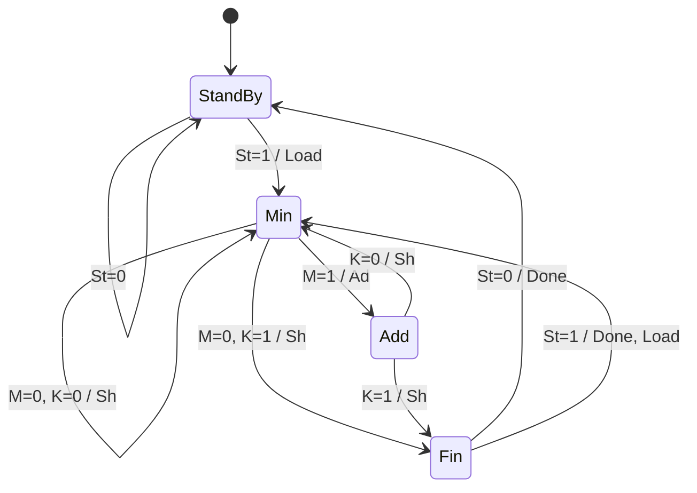

# 4-bit Shift-Add Multiplier (Roth & Kinney 18.2 / Fig. 19-10)
 
## Overview
 
| Signal | Meaning |
|---|---|
| `ACC[8:0]` | 9-bit accumulator = carry (1) + partial product (4) + multiplier (4) |
| `M` | LSB of ACC, $M = ACC[0]$ |
| `K` | Counter flag, $K = 1$ when the counter has shifted 3 times ($cnt = 3$) |
| `Load` | $ACC \leftarrow \{5'b0,\ ier\}$, counter $\leftarrow 0$ |
| `Ad` | $ACC[8:4] \leftarrow ACC[8:4] + cand$ |
| `Sh` | $ACC \leftarrow ACC \gg 1$, counter $\leftarrow cnt + 1$ |
| `Done` | Multiplication finished, $prod = ACC[7:0]$ |
 
## Controller State Table
 
| # | Present State | Input | Next State | Output | Explanation |
|:-:|---|---|---|---|---|
| 1 | StandBy | $St = 0$ | StandBy | – | Standby at the beginning |
| 2 | StandBy | $St = 1$ | Min | Load | Multiplier is loaded into the lower 4 bits; $M$ is sent to the controller |
| 3 | Min | $M = 0,\ K = 0$ | Min | Sh | No addition, just shift |
| 4 | Min | $M = 1$ | Add | Ad | Add first |
| 5 | Add | $K = 0$ | Min | Sh | After addition, shift |
| 6 | Min | $M = 0,\ K = 1$ | Fin | Sh | Last shift, then end |
| 7 | Add | $K = 1$ | Fin | Sh | Last shift after addition, then end |
| 8 | Fin | $St = 0$ | StandBy | Done | Back to standby |
| 9 | Fin | $St = 1$ | Min | Done, Load | Restart right after done (not in the textbook; S3 → S0 in Fig. 19-10) |
 
## State Assignment
 
| $Q_0 \backslash Q_1$ | 0 | 1 |
|:-:|:-:|:-:|
| **0** | StandBy (00) | Min (10) |
| **1** | Fin (01) | Add (11) |
 
## State Diagram
 

 
## Simulation Result
 
Test cases: 11×13 = 143, 5×3 = 15, 0×7 = 0, 15×15 = 225, 8×1 = 8 → **ALL PASS**
 
<!-- 파형 캡처 넣는 자리 -->

